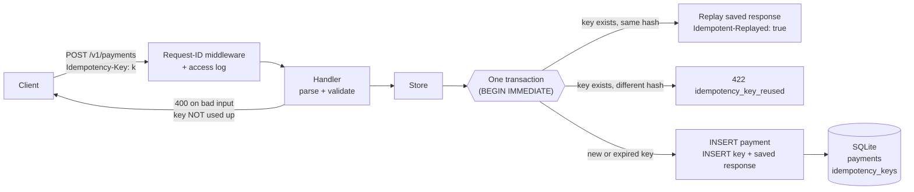

# Idempotent Payments API (Go)

[](https://github.com/Sammers45/idempotent-payments-go/actions/workflows/ci.yml)

A small HTTP service that creates payments safely: if a client retries a request (because of a timeout, a dropped connection or a crash), the payment is created **once** and every retry gets back the original response.

**Why this matters in payments.** Networks fail in the worst place: after the server charged the card but before the client heard back. The client can't tell "it failed" from "it worked but the reply was lost", so it retries. Without idempotency, that retry charges the customer twice. Stripe's answer is the `Idempotency-Key` header, and this service implements the same idea, including the hard part: two retries arriving at the same instant.

## Architecture



```
cmd/server/          entry point: config, timeouts, graceful shutdown, expired-key sweeper
internal/payments/   domain rules: validation, money, request fingerprint (no HTTP, no SQL)
internal/store/      SQLite: the idempotency transaction
internal/httpapi/    routes, handlers, JSON errors, request-ID middleware
```

## Key design decisions and trade-offs

**A unique constraint plus a transaction, not an in-memory lock.** A per-key mutex only protects one process. Run two instances behind a load balancer and two retries can land on different instances and both charge. The database is the one thing every instance shares, so the guarantee lives there: `idempotency_keys.key` is a primary key, and the payment row and the key row are written in the same transaction, so neither can exist without the other. Transactions start with `BEGIN IMMEDIATE`, so concurrent requests for the same key wait their turn; if two inserts ever do collide, the loser gets a constraint error, retries once, and replays the winner's response.

**The saved response is replayed byte for byte.** The handler builds the response body _before_ the transaction and stores those exact bytes with the key. A retry gets the same status and body, so clients never see two different payment IDs for one logical request.

**Key reuse with a different body is an error (422), not a retry.** The store keeps a SHA-256 fingerprint of the request. If the same key comes back with a different amount, that's a client bug (reusing a key for a second payment), and guessing which request they meant would be worse than refusing. The fingerprint is taken over the _parsed, normalized_ request rather than raw bytes, so a retry with reordered JSON keys, different whitespace or `"USD"` vs `"usd"` is still recognized as the same request.

**Validation errors don't use up the key.** Bad input is rejected before the transaction, so nothing is saved, and the client can fix the body and retry with the same key. (Stripe behaves the same way.) Server errors (500) also roll back, so they're safe to retry.

**Money is `int64` cents plus a currency code.** Floats can't represent most decimal fractions exactly (`0.1 + 0.2 != 0.3`). The decoder rejects `10.5` and `"1000"` as amounts, and a `CHECK (amount > 0)` in the schema backs up the validation. Supported currencies (`usd`, `eur`, `gbp`, `cad`) all have two decimal places; zero-decimal currencies like JPY would need different handling.

**Keys expire after 24 hours.** Expiry is checked when a key is looked up, so correctness doesn't depend on a background job. An hourly sweeper only deletes old key rows so the table doesn't grow forever. Payments are never deleted.

**Strict input.** Unknown fields are rejected (a typo like `"ammount"` would otherwise silently become amount 0), bodies are capped at 64 KiB, and trailing data after the JSON object is an error.

**Operational basics.** Every response has a server-generated `Request-Id` header, and every log line (JSON via `log/slog`) includes it. The server has read, write, header and idle timeouts (the header timeout blocks Slowloris-style attacks) and drains in-flight requests on SIGTERM before closing the database.

## API

| Method | Path                | Description                                                                                                          |
| ------ | ------------------- | -------------------------------------------------------------------------------------------------------------------- |
| `POST` | `/v1/payments`      | Create a payment. Requires `Idempotency-Key`. Body: `amount` (int, cents), `currency`, `customer_id`. Returns `201`. |
| `GET`  | `/v1/payments/{id}` | Fetch a payment. `404` if unknown.                                                                                   |
| `GET`  | `/healthz`          | Liveness check.                                                                                                      |

Errors always look like this:

```json
{
  "error": {
    "type": "invalid_request_error",
    "code": "amount_invalid",
    "message": "amount must be a positive integer ..."
  }
}
```

`type` is one of `invalid_request_error` (fix the request), `idempotency_error` (key reused) or `api_error` (our fault; safe to retry with the same key).

## Run it locally

Requires Go (version in `go.mod`). No C compiler needed: the SQLite driver is pure Go.

```bash
cp .env.example .env      # optional: ADDR and DB_PATH have defaults
go run ./cmd/server       # or: make run
```

### curl (macOS / Linux / Git Bash)

```bash
# Create a payment
curl -i -X POST localhost:8080/v1/payments \
  -H 'Idempotency-Key: order-42' -H 'Content-Type: application/json' \
  -d '{"amount":1000,"currency":"usd","customer_id":"cus_123"}'

# Retry it: same body and payment id back, plus "Idempotent-Replayed: true"
curl -i -X POST localhost:8080/v1/payments \
  -H 'Idempotency-Key: order-42' -H 'Content-Type: application/json' \
  -d '{"amount":1000,"currency":"usd","customer_id":"cus_123"}'

# Same key, different amount: 422 idempotency_key_reused
curl -i -X POST localhost:8080/v1/payments \
  -H 'Idempotency-Key: order-42' -H 'Content-Type: application/json' \
  -d '{"amount":2000,"currency":"usd","customer_id":"cus_123"}'

# Fetch it (use the id from the create response)
curl -i localhost:8080/v1/payments/pay_<id>

# Health check
curl -i localhost:8080/healthz
```

### PowerShell (Windows)

```powershell
$body = '{"amount":1000,"currency":"usd","customer_id":"cus_123"}'
$p = Invoke-RestMethod -Method Post -Uri http://localhost:8080/v1/payments `
  -Headers @{ "Idempotency-Key" = "order-42" } -ContentType "application/json" -Body $body
$p                                                    # run the line above again: same id
Invoke-RestMethod http://localhost:8080/v1/payments/$($p.id)
Invoke-RestMethod http://localhost:8080/healthz
```

## Tests

```bash
go test -count=1 ./...          # all platforms
go test -race -count=1 ./...    # Linux/macOS, or Windows with a C compiler; CI runs this on every push
make lint                       # golangci-lint v2
```

**20 test functions, all passing, plus 23 table-driven subtests.** What they cover:

- **Idempotency:** a retry returns the original response; a reformatted body is still a retry; the same key with a different body returns 422; a rejected request doesn't use up its key.
- **Concurrency:** 50 goroutines send the same key at the same instant, and exactly **1** payment is created while the other 49 get the replayed response. This is tested twice, through HTTP and directly against the store. It passes under `-race` in CI.
- **Expiry:** a key is still live 1 second before 24 hours and forgotten at exactly 24 hours (fake clock); the sweeper deletes expired keys but never payments.
- **Validation:** 13 bad-input cases over HTTP (missing or too-long key, zero, negative, float or string amount, unsupported or missing currency, missing customer, unknown field, not JSON, trailing data, oversized body), plus 10 unit cases.
- **Plumbing:** health check, a unique request ID on every response (including 404s), 405 on the wrong method.

Coverage (`go test -cover ./...`): `payments` 94.1%, `httpapi` 87.9%, `store` 74.1%. The uncovered lines are mostly database-failure branches, which would need fault injection to test.

Size: 656 lines of Go in the service, 575 lines of tests.

## Performance

One quick local run with [`hey`](https://github.com/rakyll/hey), 2,000 requests from 50 concurrent clients, on a Windows developer laptop (`server.exe` built with `go build`, SQLite file on local disk):

| Scenario                                       | Responses     | p50    | p95     | p99      | Requests/sec |
| ---------------------------------------------- | ------------- | ------ | ------- | -------- | ------------ |
| Retry storm: `POST` with one key (replay path) | 2,000 × `201` | 0.5 ms | 54.0 ms | 231.4 ms | 2,888        |
| `GET /v1/payments/{id}`                        | 2,000 × `200` | 5.8 ms | 18.3 ms | 25.4 ms  | 6,260        |

`hey` sends identical headers on every request, so the POST test is a retry storm: every request after the first replays the saved response, and all 2,000 got the same `201`. The create path (a new key per request) needs a load tool that can vary the header; see "What I'd do next".

**Reading the numbers.** The replay path has a fast median but a long tail (p99 is about 460× the p50). That's the design showing through: a replay still runs inside a `BEGIN IMMEDIATE` transaction, so all 50 clients queue for SQLite's single write lock even though a replay writes nothing. Reads run outside that lock (WAL mode), which is why `GET` has a tighter p95/p99. The fix is listed below. These are single-run numbers from a laptop, useful for comparing the two paths, not as a capacity claim.

## Limitations and what I'd do next

- **Postgres instead of SQLite.** SQLite allows one writer at a time, which is what makes `BEGIN IMMEDIATE` simple here but caps write throughput. On Postgres the same design works with `INSERT ... ON CONFLICT DO NOTHING` on the key, and the constraint-violation retry path becomes the main one.
- **Keys scoped per account.** There's no authentication, so keys are global. A real API would scope them per merchant (primary key `(account_id, key)`), so two merchants can't collide.
- **In-progress requests.** A request that crashes mid-transaction rolls back cleanly, but with a real card network call in the middle you'd save the key in a "started" state first and return `409` to concurrent retries while it runs, instead of holding a database lock across a network call.
- **A read-only fast path for replays.** Look the key up with a plain read first and return the saved response without taking the write lock; only fall through to the `BEGIN IMMEDIATE` transaction when the key is new. That should cut the retry-storm tail latency measured above; I'd re-run the same `hey` test to confirm.
- **Create-path load test** with a small Go load generator that uses a fresh key per request.
- **Observability:** Prometheus metrics (request latency, replay rate, 422 rate) and tracing.
- **Rate limiting** per API key.
